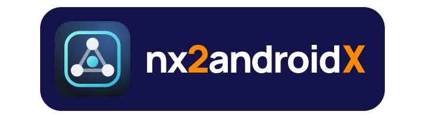
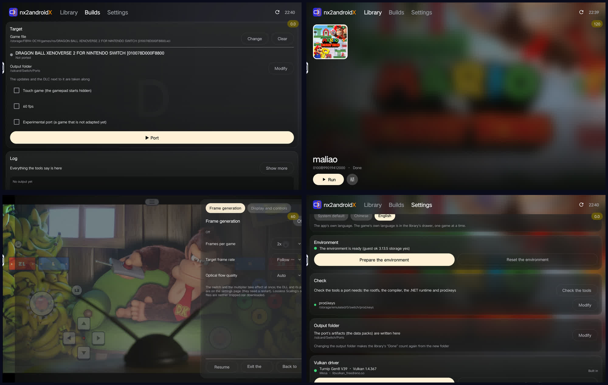

<h1 align="center">
  
</h1>

> **English**. 中文文档：[README.zh.md](README.zh.md)

**SwitchOS for Android** is the phone side of [SwitchOS](../README.md): it ports your own Switch games to Android and runs them natively. The game's own arm64 code runs on the device, the Switch's system services are stood in for by a host, and NVN graphics are replayed on Vulkan. Pick the game's file, start a port, and play it from the library — no computer in the loop.

On the PC, SwitchOS runs the same games as static recompilations, launched from the SwitchOS hub. Saves keep the Switch's own format on both sides and are matched by the game's title ID, so the same save moves between the PC and the phone without conversion.

Bring your own game files and keys: this repository holds no game content and no keys.

---

## What the app does

*Top left: starting a port on the Builds tab; top right: a game entry in the library; bottom left: the in-game drawer's frame generation; bottom right: the Settings tab (language, environment, keys, Vulkan drivers).*

| Feature | What it is |
|---|---|
| **Porting on the phone** | Pick a file on the Builds tab and the port starts; it runs in the background and the game is playable when it is done |
| **A glibc rootfs** | The app carries a glibc rootfs of its own, and the porting tools are Linux binaries that run on the device itself: no proot, no root, no compatibility layer |
| **The game is a page of the app** | Ending the game falls back to the library, and the recents hold one entry |
| **Saves you can share** | An export becomes a package handed to the system share sheet; an import takes one in from anywhere; the save it replaces is backed up first |
| **An in-game drawer** | The ☰ menu button opens it: performance, HUD, frame generation and controls |
| **Frame generation** | Available while the game runs; the multiplier and the target frame rate take effect at once |
| **A steady frame rate** | Hold the frame rate step (60, 40 or 30) and choose the docked mode, per game |
| **Vulkan driver management** | Download (Turnip builds), import from a file or remove, in the Settings tab; one Turnip build ships inside the app |
| **Shareable logs** | The library's drawer shares the game's runtime log; the Settings tab clears it |

### Onboarding

The first launch walks four steps: storage access → environment → keys → done. The environment (rootfs, the build tools and the .NET runtime, about 700 MB) is unpacked once; later updates of the app only carry the new small tools. Skipped steps are not fatal: they can be made up in the Settings at any time, and the library's entry says what is missing.

### The in-game drawer

The ☰ menu button opens the drawer, with four tabs:

- **Performance**: the frame rate step (*follow the game*, or hold 60, 40 or 30 fps) and the docked mode, which renders at the TV's resolution — sharper, at the cost of power.
- **HUD**: the performance line, the device line, the fields it shows and the temperature's unit.
- **Frame generation**: uses Lossless.dll — the multiplier, the target frame rate and the optical flow quality. The DLL is the player's own file: it is neither bundled nor downloaded, and we do not link to a download.
- **Controls**: the virtual gamepad's layout editor (drag, pinch to resize, snap to grid), its opacity and the rumble.

### Vulkan drivers

The **Vulkan driver** section of the Settings tab downloads Mesa's Turnip builds from their own addresses, imports one from a file, or removes one. One Turnip build (Adreno 8xx) ships inside the app and unpacks itself on start. The driver a game runs with is picked in the library's drawer, the device's own driver first; the choice is kept in the data pack's `env.txt` and takes effect the next time the game starts.

## Requirements

- **Android 8.0 (API 26) or newer**.
- **1.5 GB of free space to start**: the APK is about 272 MB and the environment unpacked on the first launch about 700 MB, on top of your own game files and the data packs.
- **A GPU that reads BC-compressed textures**: developed and tested on Qualcomm **Adreno** (Snapdragon). Xclipse (Exynos 2200 and later) should read BC textures too, but is untested.
- **Other GPUs (Mali/Immortalis, PowerVR)**: untested. They do not read BC textures, so the runtime decodes them on the CPU — slower, and more memory.
- **Your own game files and `prod.keys`**, dumped from your own Switch: the app never downloads either.

## Playing a game

1. **Install the APK**: build it with `bash packaging/android-apk/build_apk.sh [debug|release]` and install it with the system installer or `adb install`.
2. **First start**: walk the onboarding (storage access → environment → keys → done).
3. **Builds tab**: tap **Choose a game file**, pick the base game (the updates and the DLC next to it are taken along), then tap **Start a port**. The port runs in the background; the notification bar keeps the progress.
4. **Library tab**: when the port is done the data pack is in the library — tap **Run** and play.

The port's own options sit on the Builds tab: **Touch game** (the on-screen gamepad starts hidden), **60 fps** and **Experimental port** (a game that is not adapted yet).

Pokémon Legends: Arceus and Pokémon Legends: Z-A keep their shaders in Oodle-compressed archives that only the game's own decoder can open; the phone decodes them during the port, so nothing else is needed.

The games ported so far, and the ones next, are in [docs/PORT_CHECKLIST.md](docs/PORT_CHECKLIST.md).

## Saves

**In the app**: the library page → the drawer → **Saves**. **Export the saves** writes the save as a zip where the system file manager says; **Import the saves…** takes a zip from anywhere the file manager can see. An import replaces the game's save, so the app asks first and backs the old one up. A package carrying another game's title ID is refused, and the unpacked size is capped. Uninstalling the app deletes its saves: copy them out first.

**With the PC**: `python switchos.py sync` in the SwitchOS root syncs the phone's saves (over adb) with the PC and the cloud folder, three ways, and keeps a backup before anything is replaced. Reading the app's private folder needs a debuggable APK (`run-as`); otherwise, export the save in the app and put the package in the cloud folder.

## For developers

Start with [docs/GETTING_STARTED.md](docs/GETTING_STARTED.md): the tools to install, the working loop on the phone, the tests. The command line, the repository layout and the commit messages: [docs/DEVELOPMENT_GUIDE.md](docs/DEVELOPMENT_GUIDE.md). How it is put together: [docs/ARCHITECTURE.md](docs/ARCHITECTURE.md). Contribution rules: [CONTRIBUTING.md](CONTRIBUTING.md).

## Keys and game files

Reading your game files while porting them needs your `prod.keys` — the keys your own console uses. This repository contains no keys, no game files, no firmware and nothing extracted from them; the app never downloads any of them, and this project provides no method or link to obtain keys. Dump both from your own Switch, and don't share them or the data packs built from them.

The app is for running personal backups of the games you own. How you obtain the game files and the keys, and whether that is legal where you live, is for you to judge and to answer for.

The game profiles under `nxnative/dm/games/` hold interoperation metadata only: shader hashes, module offsets and patch stubs of a few bytes that make a particular game build run.

## License

This tree is a fork of nx2androidX and stays under its terms: the code it owns — the porter, the phone app, the packaging, the docs and the nxnative engine fork — is GPL-3.0-or-later ([LICENSE](LICENSE)). When the APK is distributed, its source is published under the same terms. [NOTICE.md](NOTICE.md) says who holds the copyright on what; the third-party code in the tree keeps its own license, listed in [THIRD_PARTY_NOTICES.md](THIRD_PARTY_NOTICES.md). The frame generation code ([nxnative/dm/android/lsfg/](nxnative/dm/android/lsfg/)) is GPL-3.0-or-later as well; see [android/NOTICE.md](android/NOTICE.md).

## Credits

SwitchOS stands on these projects. Thank you to everyone who built them.

**Android (this tree)**

- **[zFitness/nx2androidX](https://github.com/zFitness/nx2androidX)** — the fork this tree continues: porting and playing on the phone itself, and its contributors.
- **[shirai91/nx2android](https://github.com/shirai91/nx2android)** — the porter that nx2androidX is built on.
- **[seedds/nxnative](https://github.com/seedds/nxnative)** — the engine underneath: the Horizon host, the NVN-on-Vulkan replay, the shader translator and the game profiles (MIT upstream; the fork in `nxnative/` is GPL-3.0-or-later).

**PC (the SwitchOS engines)**

- **[Hexveil404/PokeZ-ARecomp](https://github.com/Hexveil404/PokeZ-ARecomp)** — Pokémon Legends: Z-A, and the runtime the SwitchOS hub launches.
- **[CarlosExabyte/Arceuszada](https://github.com/CarlosExabyte/Arceuszada)** — Pokémon Legends: Arceus.
- **[raulzrrs/swsh-recomp](https://github.com/raulzrrs/swsh-recomp)** — Pokémon Sword and Shield.
- **[Veemyu/strahlender-xnu](https://github.com/Veemyu/strahlender-xnu)** — Pokémon Brilliant Diamond.
- **[valentderah/totk-pc-recomp](https://github.com/valentderah/totk-pc-recomp)** — The Legend of Zelda: Tears of the Kingdom.

**Tools the app can use**

- **[Mesa](https://www.mesa3d.org/)** — Turnip, the Vulkan driver the app can download for Adreno GPUs.
- **Lossless Scaling** — Lossless.dll, the frame generator the app can use; its resources are neither bundled nor downloaded here.

## Trademarks

Switch, NVN and the game names in this README are trademarks of Nintendo and of the respective publishers and developers; they are used here only to identify the games this tool works with and to explain technical details. The screenshot is of the app itself, running the player's own game files. This project is not affiliated with, endorsed by or sponsored by them.
