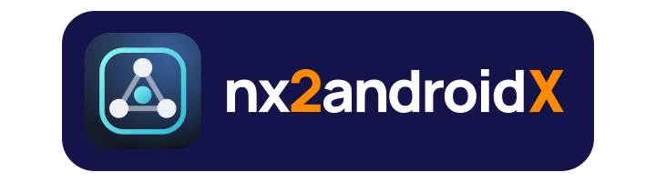
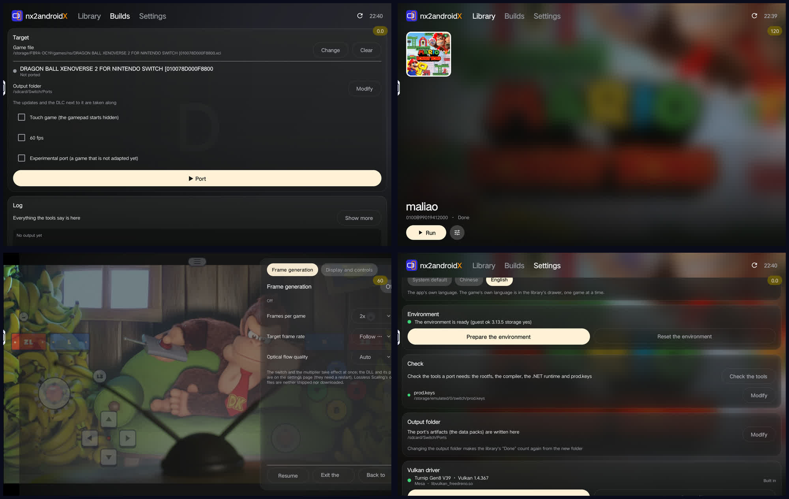

<h1 align="center">
  
</h1>

> **中文**。English: [README.md](README.md)

**SwitchOS for Android** 是 [SwitchOS](../README.md) 的手机端：把你自己的 Switch 游戏移植到 Android 并原生运行。游戏自己的 arm64 代码直接在设备上执行，Switch 的系统服务由宿主代替，NVN 图形在 Vulkan 上重放。选好游戏文件、开始移植，然后在库里直接玩——全程不需要电脑。

在 PC 上，SwitchOS 用静态重编译运行同样的游戏，由 SwitchOS hub 启动。两边的存档都保持 Switch 原本的格式，按游戏的 title ID 对应，所以同一份存档可以在 PC 和手机之间直接互通，无需转换。

游戏文件和密钥请自备：本仓库不包含任何游戏内容和密钥。

---

## App 能做什么

| 功能 | 说明 |
|---|---|
| **在手机上移植** | 在构建页选好文件即开始移植，后台运行，完成后即可游玩 |
| **自带 glibc rootfs** | App 自带 glibc rootfs，移植工具是直接在设备上运行的 Linux 程序：不用 proot、不用 root、没有兼容层 |
| **游戏是 App 的一页** | 结束游戏会回到库，最近任务里只有一个条目 |
| **可分享的存档** | 导出生成存档包并交给系统分享面板；导入可来自任何地方；被替换的存档会先备份 |
| **游戏内抽屉** | ☰ 菜单键打开：性能、HUD、补帧和操控 |
| **补帧** | 游戏运行时可用，倍数和目标帧率即时生效 |
| **稳定帧率** | 每个游戏可锁定帧率档位（60、40 或 30）并选择底座模式 |
| **Vulkan 驱动管理** | 在设置页下载（Turnip）、从文件导入或删除；App 内置一个 Turnip 版本 |
| **可分享的日志** | 库的抽屉可分享游戏运行日志；设置页可清除 |

### 首次启动

首次启动有四步：存储权限 → 环境 → 密钥 → 完成。环境（rootfs、构建工具和 .NET 运行时，约 700 MB）只解压一次。跳过的步骤可以随时在设置里补上，库的条目会说明缺什么。

### 游戏内抽屉

- **性能**：帧率档位（跟随游戏，或锁定 60、40、30 fps）和底座模式（按电视分辨率渲染，更清晰但更耗电）。
- **HUD**：性能行、设备行、显示的字段和温度单位。
- **补帧**：使用 Lossless.dll，可调倍数、目标帧率和光流质量。DLL 是玩家自己的文件：既不随附也不下载，我们也不提供下载链接。
- **操控**：虚拟手柄的布局编辑器（拖动、双指缩放、网格吸附）、不透明度和振动。

### Vulkan 驱动

设置页的 **Vulkan 驱动** 一节可以从 Mesa 自己的地址下载 Turnip、从文件导入或删除。App 内置一个 Turnip 版本（Adreno 8xx），启动时自动解压。每个游戏使用的驱动在库的抽屉里选择（设备自带驱动排第一），选择保存在数据包的 `env.txt` 里，下次启动游戏时生效。

## 需求

- **Android 8.0（API 26）或更新**。
- **起步需要 1.5 GB 空闲空间**：APK 约 272 MB，首次启动解压的环境约 700 MB，另加你的游戏文件和数据包。
- **支持 BC 压缩纹理的 GPU**：在高通 **Adreno**（骁龙）上开发和测试。Xclipse（Exynos 2200 及以后）应该也支持，但未测试。
- **其他 GPU（Mali/Immortalis、PowerVR）**：未测试。它们不支持 BC 纹理，运行时会在 CPU 上解码，更慢、更占内存。
- **你自己的游戏文件和 `prod.keys`**，从你自己的 Switch 导出：App 从不下载这两样。

## 开始游玩

1. **安装 APK**：用 `bash packaging/android-apk/build_apk.sh [debug|release]` 构建，再用系统安装器或 `adb install` 安装。
2. **首次启动**：完成引导（存储权限 → 环境 → 密钥 → 完成）。
3. **构建页**：点 **选择游戏文件**，选本体（同目录的更新和 DLC 会一起带上），再点 **开始移植**。移植在后台运行，通知栏显示进度。
4. **库页**：移植完成后数据包会出现在库里，点 **运行** 即可游玩。

构建页还有移植选项：**触屏游戏**（屏幕手柄默认隐藏）、**60 fps** 和 **实验性移植**（尚未适配的游戏）。

《宝可梦传说 阿尔宙斯》和《宝可梦传说 Z-A》的着色器保存在 Oodle 压缩包里，只有游戏自己的解码器能打开；手机会在移植时完成解码，无需其他步骤。

已移植和计划中的游戏见 [docs/PORT_CHECKLIST.md](docs/PORT_CHECKLIST.md)。

## 存档

**在 App 里**：库页 → 抽屉 → **存档**。**导出存档** 把存档写成 zip，放到系统文件管理器指定的位置；**导入存档…** 可以从文件管理器能看到的任何地方读取 zip。导入会替换游戏的存档，所以 App 会先询问并备份旧存档。title ID 不属于该游戏的存档包会被拒绝，解压大小也有上限。卸载 App 会删除它的存档：请先复制出来。

**和 PC 同步**：在 SwitchOS 根目录运行 `python switchos.py sync`，会（通过 adb）把手机的存档与 PC 和云端文件夹做三方同步，替换前一定会先备份。读取 App 的私有目录需要可调试的 APK（`run-as`）；否则请在 App 里导出存档，再把存档包放进云端文件夹。

## 开发者

从 [docs/GETTING_STARTED.md](docs/GETTING_STARTED.md) 开始：要装的工具、手机上的开发循环和测试。命令行、仓库结构和提交信息：[docs/DEVELOPMENT_GUIDE.md](docs/DEVELOPMENT_GUIDE.md)。整体结构：[docs/ARCHITECTURE.md](docs/ARCHITECTURE.md)。贡献规则：[CONTRIBUTING.md](CONTRIBUTING.md)。

## 密钥和游戏文件

移植时读取游戏文件需要你的 `prod.keys`——你自己主机使用的密钥。本仓库不包含任何密钥、游戏文件、固件或从中提取的内容；App 从不下载它们，本项目也不提供获取密钥的方法或链接。请从你自己的 Switch 导出，不要分享它们或用它们生成的数据包。

本 App 用于运行你拥有的游戏的个人备份。游戏文件和密钥如何获得、在你所在地是否合法，由你自己判断并负责。

`nxnative/dm/games/` 下的游戏档案只包含互操作元数据：着色器哈希、模块偏移，以及让特定游戏版本运行的几个字节的补丁。

## 许可证

本目录是 nx2androidX 的 fork，沿用其条款：它自己拥有的代码——porter、手机 App、打包、文档和 nxnative 引擎 fork——采用 GPL-3.0-or-later（[LICENSE](LICENSE)）。分发 APK 时，其源代码按相同条款公开。版权归属见 [NOTICE.md](NOTICE.md)；目录中的第三方代码保留各自的许可证，列在 [THIRD_PARTY_NOTICES.md](THIRD_PARTY_NOTICES.md)。补帧代码（[nxnative/dm/android/lsfg/](nxnative/dm/android/lsfg/)）同样是 GPL-3.0-or-later，见 [android/NOTICE.md](android/NOTICE.md)。

## 致谢

SwitchOS 建立在这些项目之上，感谢所有构建它们的人。

**Android（本目录）**

- **[zFitness/nx2androidX](https://github.com/zFitness/nx2androidX)**——本目录延续的 fork：直接在手机上移植和游玩，以及它的贡献者。
- **[shirai91/nx2android](https://github.com/shirai91/nx2android)**——nx2androidX 所基于的移植工具。
- **[seedds/nxnative](https://github.com/seedds/nxnative)**——底层引擎：Horizon 宿主、NVN-on-Vulkan 重放、着色器翻译器和游戏档案（上游为 MIT；`nxnative/` 中的 fork 为 GPL-3.0-or-later）。

**PC（SwitchOS 的引擎）**

- **[Hexveil404/PokeZ-ARecomp](https://github.com/Hexveil404/PokeZ-ARecomp)**——《宝可梦传说 Z-A》，以及 SwitchOS hub 启动的运行时。
- **[CarlosExabyte/Arceuszada](https://github.com/CarlosExabyte/Arceuszada)**——《宝可梦传说 阿尔宙斯》。
- **[raulzrrs/swsh-recomp](https://github.com/raulzrrs/swsh-recomp)**——《宝可梦 剑／盾》。
- **[Veemyu/strahlender-xnu](https://github.com/Veemyu/strahlender-xnu)**——《宝可梦 晶灿钻石》。
- **[valentderah/totk-pc-recomp](https://github.com/valentderah/totk-pc-recomp)**——《塞尔达传说 王国之泪》。

**App 可使用的工具**

- **[Mesa](https://www.mesa3d.org/)**——Turnip，App 可为 Adreno GPU 下载的 Vulkan 驱动。
- **Lossless Scaling**——Lossless.dll，App 可使用的补帧器；其资源既不随附也不由我们下载。

## 商标

Switch、NVN 以及本文中的游戏名称是任天堂及相应发行商和开发商的商标；在此仅用于标明本工具兼容的游戏和说明技术细节。截图为 App 本身运行玩家自己的游戏文件。本项目与上述各方无关，也未获其认可或赞助。
